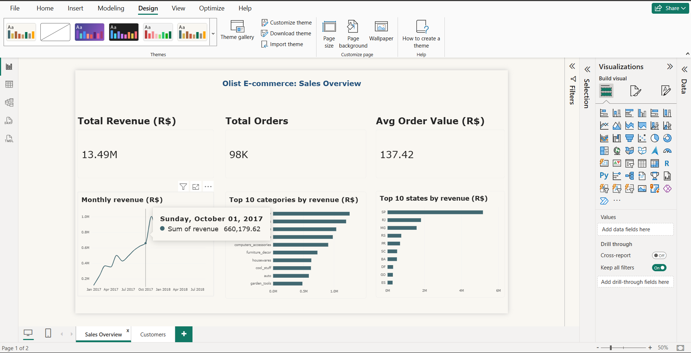
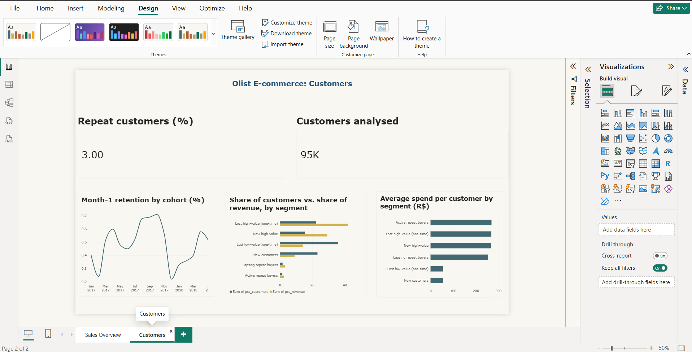
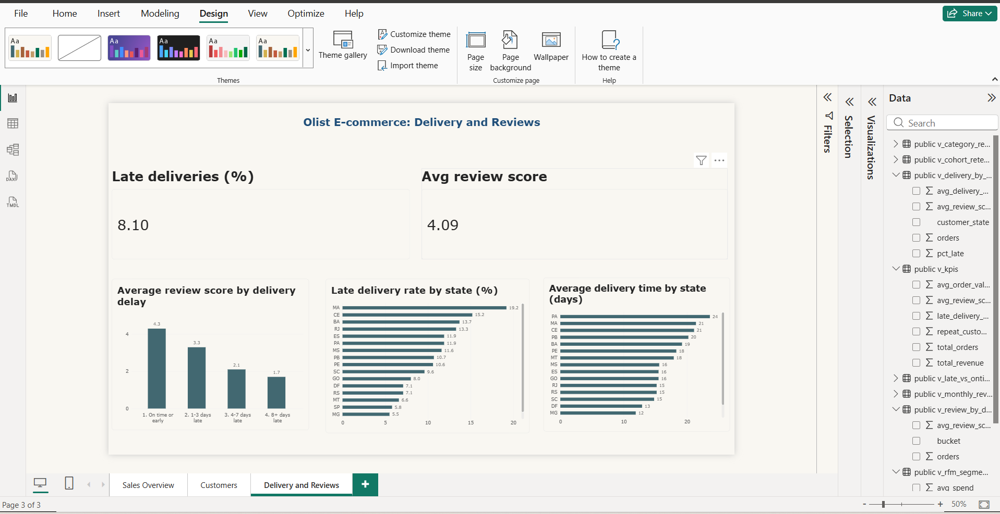

# Olist E-commerce Sales and Customer Analytics

End-to-end analysis of a Brazilian e-commerce marketplace: PostgreSQL for data modelling and analysis, Python for EDA, and a 3-page Power BI dashboard that turns the numbers into business recommendations.

**Tools:** PostgreSQL, SQL (CTEs, window functions, cohort logic), Python (pandas, SQLAlchemy, matplotlib), Power BI, Git

## Business problem

Olist connects small Brazilian sellers to large marketplaces. This project answers six questions a business team would ask:

1. How did revenue and orders trend, and which categories and states drive them?
2. Who are the best customers?
3. Do customers come back?
4. Does late delivery hurt customer satisfaction?
5. Where does delivery fail (states and sellers)?
6. How do customers pay?

## Dataset

[Brazilian E-Commerce Public Dataset by Olist](https://www.kaggle.com/datasets/olistbr/brazilian-ecommerce) (Kaggle): about 99k orders from Sep 2016 to Oct 2018, in 9 CSV files. The raw data is not stored in this repo; download it from Kaggle.

Revenue means item price, excluding canceled and unavailable orders. Trend analysis uses **Jan 2017 to Aug 2018**, because the other months have too few orders.

## Dashboard

### Sales Overview


### Customers


### Delivery and Reviews


The Power BI file is `dashboard/olist_dashboard.pbix`. Each visual reads from a PostgreSQL view (`sql/08_dashboard_views.sql`), so the logic lives in SQL and Power BI only draws the charts.

## Key findings

### Revenue
- Total revenue was about R$13.5M across about 98k orders, with an average order value of about R$137.
- Revenue grew about 2.4x year over year (Jan to Aug 2018 vs. the same months of 2017), driven by order volume. Average order value stayed flat at about R$130 to R$150.
- Growth plateaued from March 2018 at roughly R$0.85M to R$1.0M per month.
- Nov 2017 was the peak month (R$1.0M, 7,421 orders).
- Revenue is concentrated geographically: Sao Paulo contributes 38.3%, and SP + RJ + MG together 63.4%. The top 5 states account for 73.9%.
- Revenue is spread across categories: the top 10 make up 62.4% and none exceeds 9.3%. `watches_gifts` earns about R$214 per order vs. about R$110 for `bed_bath_table`.

### Customers (RFM)
- Only **3.0%** of customers (2,888 of 94,990) bought more than once.
- The top 40% of customers by spend (average about R$268) generate 71.2% of revenue. Repeat buyers generate only 5.6%.
- The largest segment by revenue is high-value one-time buyers who have not returned (22.2% of customers, 42.0% of revenue).

### Retention
- Month-1 retention by monthly cohort is between 0.2% and 0.7%, and it did not improve as the business grew.
- The Nov 2017 (Black Friday) cohort was the largest (7,190 customers) but retained only 0.56% in month 1 and 0.11% by month 6.
- Growth came almost entirely from acquiring new customers, not from repeat purchases.

### Delivery and reviews
- 8.0% of delivered orders arrived after the estimated date.
- Late orders average **2.57** stars vs. **4.29** for on-time orders. 54.1% of late orders get a 1 to 2 star review, vs. 9.2%.
- Review scores fall as delays grow: 3.29 (1 to 3 days late), 2.10 (4 to 7 days), 1.70 (8+ days).
- Late rates by state: MA 19.2%, CE 15.2%, BA 13.7%, RJ 13.3%, versus SP 5.8% and PR 4.9%. Average delivery time is 8.7 days in SP and 21 to 24 days in MA, CE and PA.
- RJ is the second-largest revenue state but has a late rate more than double SP's.
- The 10 worst sellers (50+ orders) are late 21% to 30% of the time, versus the 8.0% platform average.

### Payments
- Credit cards account for 75.3% of orders and about 78% of payment value. Boleto (bank slip) is second at 19.5%.
- About 67% of credit card payments use installments, and 16% use 7 or more.
- Average payment grows with installments: R$96 (single) to R$332 (7+ installments).

## Recommendations

1. **Run a second-purchase campaign** (for example post-delivery coupons) aimed at high-value one-time buyers. A small lift in repeat rate would affect a large share of revenue.
2. **Fix logistics before spending on marketing.** Late delivery costs about a full review point even at 1 to 3 days late. Prioritise the 4.7% of orders that arrive 4+ days late.
3. **Set seller performance thresholds** and review the worst-performing sellers, since the problem is concentrated.
4. **Improve carrier coverage and delivery estimates** in RJ, BA, CE and MA. RJ matters most because of its revenue share.
5. **Grow outside the southeast** with regional marketing and faster logistics for the North and Northeast.
6. **Keep flexible installment options** on high-priced items and keep boleto for customers without cards (about one in five orders).

## Data quality

The data is largely clean. Issues found and how they were handled (checks in `sql/02_data_quality_checks.sql`):

| Issue | Count | Handling |
|---|---|---|
| Orders not delivered (canceled, unavailable, in transit) | 2,963 | Excluded from revenue analysis |
| Delivered orders missing delivery date | 8 | Excluded from delivery metrics |
| Orders with no items | 775 | Excluded (no revenue) |
| Duplicate review IDs | 789 | Reduced to one review per order |
| Orders with multiple reviews | 547 | Latest review used |
| Products with no category | 610 | Labelled "unknown" |
| Orphan order items | 0 | Referential integrity intact |

## Limitations

- Review analysis shows association, not proof of cause, and includes only customers who left a review.
- "Late" means delivered after the estimated date. Seller delays and carrier delays are not separated.
- "Lost" customers in the RFM segments are defined relative to other customers' recency, not as confirmed churn.
- Data ends in Oct 2018, so recent cohorts show zeros for months not yet observed.

## Repository structure

```
olist-ecommerce-analytics/
├── README.md
├── requirements.txt
├── scripts/
│   └── load_data.py            # loads the 9 CSVs into PostgreSQL
├── sql/
│   ├── 01_create_tables.sql
│   ├── 02_data_quality_checks.sql
│   ├── 03_revenue_analysis.sql
│   ├── 04_customer_rfm.sql
│   ├── 05_cohort_retention.sql
│   ├── 06_delivery_vs_reviews.sql
│   ├── 07_payments_analysis.sql
│   └── 08_dashboard_views.sql
├── notebooks/
│   └── 01_eda.ipynb
├── data/processed/
└── dashboard/
    ├── olist_dashboard.pbix
    ├── olist_theme.json
    └── screenshots/
```

## How to reproduce

1. Install PostgreSQL and create a database named `olist`.
2. Download the dataset from Kaggle and place the 9 CSV files in `data/raw/`.
3. Create the environment and install dependencies:
   ```
   python -m venv venv
   venv\Scripts\activate
   pip install -r requirements.txt
   ```
4. Create the tables by running `sql/01_create_tables.sql` in pgAdmin or psql.
5. Load the data (it prompts for your PostgreSQL password):
   ```
   python scripts\load_data.py
   ```
6. Run the SQL files `02` to `08` in order. File `08` creates the views used by the dashboard.
7. Open `dashboard/olist_dashboard.pbix` in Power BI Desktop, point it to your local PostgreSQL (`localhost`, database `olist`), and refresh.

## Skills demonstrated

SQL (joins, CTEs, window functions, cohort and RFM logic), data quality validation, Python (pandas, SQLAlchemy, matplotlib), dimensional thinking, Power BI dashboards, and turning analysis into business recommendations.

## Author

**Ramesh Dasari** · [GitHub](https://github.com/Ramesh-Dasari-6875)
